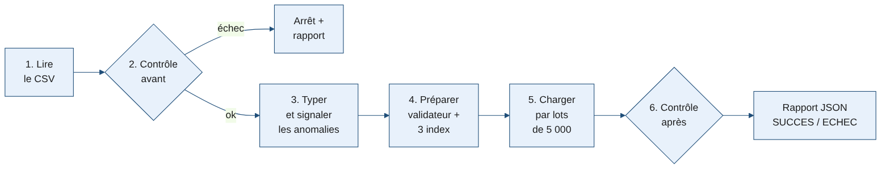
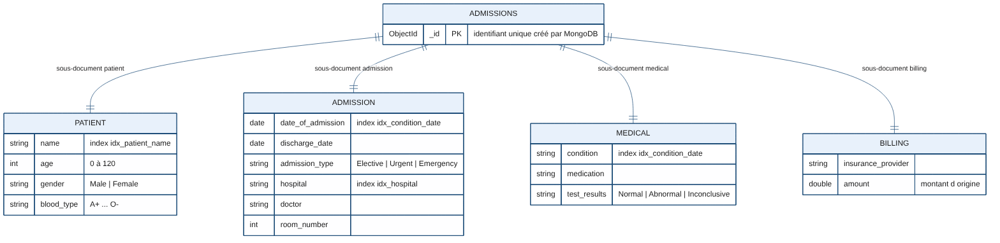
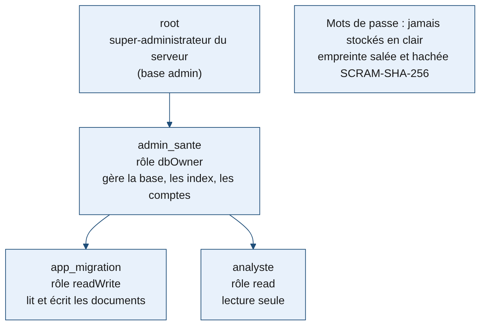
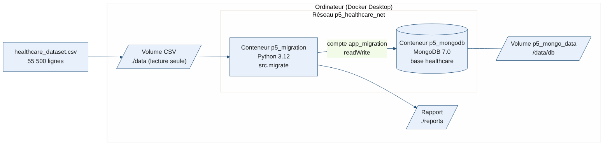

# Migration de données médicales vers MongoDB avec Docker

Projet réalisé pour **DataSoluTech**, dans le cadre du parcours Data Engineer d'OpenClassrooms (projet 5).

Un client de DataSoluTech gère les admissions de ses patients dans un fichier CSV et rencontre des **problèmes de scalabilité**. Ce dépôt migre automatiquement ces données vers **MongoDB**, une base NoSQL qui peut s'étendre horizontalement (on ajoute des serveurs au lieu d'en grossir un seul). Le tout est **conteneurisé avec Docker** pour être portable : la même commande donne le même résultat sur n'importe quel ordinateur ou serveur.

---

## Sommaire

1. [Ce que fait le programme](#1-ce-que-fait-le-programme)
2. [Contenu du dépôt](#2-contenu-du-dépôt)
3. [Déployer pas à pas](#3-déployer-pas-à-pas)
4. [Logique de la migration](#4-logique-de-la-migration)
5. [Schéma de la base de données](#5-schéma-de-la-base-de-données)
6. [Authentification et rôles utilisateurs](#6-authentification-et-rôles-utilisateurs)
7. [Tests](#7-tests)
8. [Architecture Docker](#8-architecture-docker)
9. [Choix techniques](#9-choix-techniques)

---

## 1. Ce que fait le programme

| Entrée | Traitement | Sortie |
|---|---|---|
| `healthcare_dataset.csv` : 55 500 admissions, 15 colonnes | contrôle → typage → transformation → chargement → contrôle | base `healthcare`, collection `admissions` : 55 500 documents + rapport `reports/rapport_migration.json` |

La migration est **fidèle** : aucune ligne n'est supprimée et aucune valeur n'est modifiée. Seuls les types sont convertis. Les anomalies détectées (doublons, montants négatifs, casse des noms) sont **signalées** dans le rapport ; les corriger est une décision du client.

Le programme s'arrête et le signale si les données ne sont pas fiables (colonne manquante, valeur inconnue, date incohérente) ou si un contrôle échoue après le chargement.

## 2. Contenu du dépôt

```
.
├── docker-compose.yml          # les 2 services, le réseau et les volumes
├── Dockerfile                  # image du script de migration
├── requirements.txt            # modules Python et leurs versions
├── .env.example                # modèle du fichier des mots de passe
├── docker/mongo-init/
│   └── 01_create_users.js      # création des comptes et des rôles
├── src/
│   ├── config.py               # paramètres (lus dans les variables d'environnement)
│   ├── transform.py            # lecture, typage, CSV -> documents
│   ├── integrity.py            # contrôles avant et après migration
│   ├── migrate.py              # script principal
│   ├── crud_demo.py            # démonstration Create / Read / Update / Delete
│   └── export_data.py          # export de toutes les données (JSON)
├── tests/                      # 18 tests automatisés (pytest)
├── docs/                       # schémas (base, architecture, rôles, pipeline)
├── data/                       # y déposer le CSV (non versionné)
└── reports/                    # le rapport de migration y est écrit
```

## 3. Déployer pas à pas

### Prérequis

- **Docker Desktop** installé et démarré ([téléchargement](https://www.docker.com/products/docker-desktop/)). Sous Windows, il utilise WSL 2.
- **Git** installé.
- Le fichier `healthcare_dataset.csv` fourni par le client.

### Étapes

**1. Récupérer le projet**
```bash
git clone <URL_DU_DEPOT>
cd <NOM_DU_DEPOT>
```

**2. Déposer le CSV** dans le dossier `data/` :
```
data/healthcare_dataset.csv
```

**3. Créer le fichier des mots de passe** à partir du modèle, puis remplacer chaque `changer_moi_...` :
```bash
cp .env.example .env          # Windows PowerShell : copy .env.example .env
```

**4. Lancer la migration**
```bash
docker compose up --build
```
Docker télécharge MongoDB, construit l'image du script, démarre la base, attend qu'elle soit prête, puis lance la migration. La dernière ligne attendue est :
```
p5_migration  | ... | Migration terminée : SUCCES (rapport : /app/reports/rapport_migration.json)
p5_migration exited with code 0
```

**5. Vérifier le résultat**
- Le rapport : `reports/rapport_migration.json`.
- La base, avec le compte analyste (lecture seule) :
```bash
docker exec -it p5_mongodb mongosh -u analyste -p <MOT_DE_PASSE> --authenticationDatabase healthcare healthcare --eval "db.admissions.countDocuments()"
```
Résultat attendu : `55500`.

**6. Démontrer le CRUD** (optionnel)
```bash
docker compose run --rm migration python -m src.crud_demo
```

**7. Exporter l'ensemble des données** (sauvegarde)
```bash
docker compose run --rm migration python -m src.export_data
```
Résultat : `reports/export_admissions.jsonl`, un document par ligne, au format JSON étendu de MongoDB (les dates restent des dates). Le script vérifie que le nombre de documents exportés est égal au nombre de documents en base. Ce fichier contient des données de santé : il n'est pas versionné.

**8. Lancer les tests** (optionnel)
```bash
docker compose run --rm migration python -m pytest -v
```

**9. Arrêter**
```bash
docker compose down        # arrête les conteneurs, garde les données
docker compose down -v     # arrête et SUPPRIME le volume de la base (repart de zéro)
```

> Les comptes utilisateurs ne sont créés qu'au **premier** démarrage, quand le volume de la base est vide. Si tu modifies le `.env` après coup, lance `docker compose down -v` puis `docker compose up --build`.

### Sans Docker (développement)

```bash
python -m venv .venv
source .venv/bin/activate          # Windows : .venv\Scripts\activate
pip install -r requirements.txt
python -m pytest                   # les tests n'ont pas besoin de MongoDB
```

## 4. Logique de la migration



| Étape | Ce qui est fait | Pourquoi |
|---|---|---|
| 1. Lire | `pandas` lit le CSV ; arrêt si une des 15 colonnes manque | Ne jamais migrer un fichier incomplet |
| 2. Contrôler avant | valeurs manquantes, doublons, valeurs hors liste, dates, âges | Savoir ce qu'on migre ; arrêt si une anomalie bloque |
| 3. Typer et signaler | dates converties en vrai type date ; doublons, montants négatifs et casse des noms comptés dans le rapport | Bien typer sans modifier les valeurs du client |
| 4. Préparer | collection recréée avec un **validateur de schéma** et **3 index** | MongoDB refuse un document mal typé ; recherches rapides |
| 5. Charger | insertion par lots de 5 000 documents | Moins d'allers-retours avec la base |
| 6. Contrôler après | nombre de documents, champs présents, types BSON, index | Prouver que rien n'a été perdu ni déformé |

**Migration fidèle : ce qui est fait et pourquoi**

L'énoncé demande de **tester** l'intégrité (doublons, valeurs manquantes, types) avant et après la migration, pas de corriger les données. Les données appartiennent au client : un stagiaire qui migre ne décide pas seul de ce qui est une erreur.

| Anomalie détectée | Nombre | Traitement | Raison |
|---|---|---|---|
| Lignes strictement identiques | 534 | **signalées, conservées** | Supprimer est une décision du client ; option `DEDUPLICATE=true` prête s'il la valide |
| Montants de facturation négatifs | 108 | **signalés, conservés** | Peut-être des avoirs ou remboursements |
| Casse irrégulière des noms (« Bobby JacksOn ») | 55 467 | **signalée, conservée** | Modifier un nom, c'est modifier une donnée du client |

- **Typage** : seule transformation appliquée, car demandée par l'énoncé. Les dates deviennent de vraies dates ; la forme change, pas le contenu.
- **Relance** : chaque exécution recrée la collection. Relancer le script donne toujours le même résultat, sans doublons ajoutés.
- **Dédoublonnage sur validation du client** : mettre `DEDUPLICATE=true` dans `.env`, puis `docker compose down -v` et `docker compose up --build`. Résultat : 54 966 documents.

## 5. Schéma de la base de données



- **Base** `healthcare` → **collection** `admissions` → **un document par admission**.
- Chaque document regroupe les 15 colonnes du CSV en **4 sous-documents** qui correspondent aux usages : `patient`, `admission`, `medical`, `billing`.

Exemple de document :
```json
{
  "_id": "ObjectId('...')",
  "patient":   { "name": "Bobby JacksOn", "age": 30, "gender": "Male", "blood_type": "B-" },
  "admission": { "date_of_admission": "ISODate('2024-01-31')", "discharge_date": "ISODate('2024-02-02')",
                 "admission_type": "Urgent", "hospital": "Sons and Miller",
                 "doctor": "Matthew Smith", "room_number": 328 },
  "medical":   { "condition": "Cancer", "medication": "Paracetamol", "test_results": "Normal" },
  "billing":   { "insurance_provider": "Blue Cross", "amount": 18856.281305978155 }
}
```

**Index**

| Nom | Champ(s) | Requête accélérée |
|---|---|---|
| `idx_patient_name` | `patient.name` | retrouver les séjours d'un patient |
| `idx_condition_date` | `medical.condition` + `admission.date_of_admission` | statistiques par pathologie et par période |
| `idx_hospital` | `admission.hospital` | activité d'un hôpital |

**Rappel des notions MongoDB**

- **Document** : un enregistrement au format JSON (stocké en BSON), l'équivalent d'une ligne, mais qui peut contenir des sous-documents.
- **Collection** : un ensemble de documents, l'équivalent d'une table, sans schéma imposé (ici, un validateur en ajoute un).
- **Base de données** : un ensemble de collections, avec ses propres utilisateurs.

## 6. Authentification et rôles utilisateurs



**Authentification** : MongoDB démarre avec l'authentification activée (variables `MONGO_INITDB_ROOT_*`). Personne ne peut lire ou écrire sans identifiant ni mot de passe.

| Compte | Rôle MongoDB | Base | Droits | Utilisé par |
|---|---|---|---|---|
| `root` | `root` | `admin` | tout le serveur | administration du serveur uniquement |
| `admin_sante` | `dbOwner` | `healthcare` | gérer la base, les collections, les index et les comptes | administrateur des données |
| `app_migration` | `readWrite` | `healthcare` | lire et écrire les documents | le script de migration |
| `analyste` | `read` | `healthcare` | lecture seule | analyses, tableaux de bord |

**Principes appliqués**

- **Moindre privilège** : chaque compte n'a que les droits dont il a besoin. Le script n'utilise pas le compte `root`.
- **Mots de passe hors du code** : ils sont dans le fichier `.env`, exclu de GitHub par `.gitignore`. Le dépôt ne contient que `.env.example`.
- **Hachage des mots de passe** : MongoDB ne stocke jamais un mot de passe en clair. Il conserve une empreinte **salée et hachée** avec le mécanisme **SCRAM-SHA-256**. Même un accès aux fichiers de la base ne révèle pas les mots de passe.

## 7. Tests

18 tests automatisés avec `pytest`. Ils utilisent `mongomock`, une base MongoDB simulée en mémoire, et n'ont donc pas besoin d'un serveur.

| Fichier | Ce qui est vérifié |
|---|---|
| `test_transform.py` | colonnes obligatoires, migration fidèle (aucune valeur modifiée), anomalies signalées, dédoublonnage en option, structure et types des documents |
| `test_integrity.py` | contrôles avant (valeur inconnue, valeur manquante, dates incohérentes) et après (document perdu, mauvais type) |
| `test_migration.py` | migration complète, relance sans doublon, option de dédoublonnage, opérations CRUD, export complet |

En plus, **chaque migration réelle** exécute les contrôles avant et après sur les vraies données, et écrit le résultat dans `reports/rapport_migration.json`.

## 8. Architecture Docker



| Élément | Nom | Rôle |
|---|---|---|
| Service | `mongodb` (conteneur `p5_mongodb`) | la base MongoDB 7.0 (image officielle) |
| Service | `migration` (conteneur `p5_migration`) | le script Python, construit avec le `Dockerfile` |
| Réseau | `p5_healthcare_net` | les deux conteneurs communiquent par leur nom de service |
| Volume | `p5_mongo_data` | les données de la base survivent à l'arrêt du conteneur |
| Volume | `./data` → `/data/csv` (lecture seule) | le CSV source |
| Volume | `./reports` → `/app/reports` | le rapport revient sur l'ordinateur |

**Conteneur ou machine virtuelle ?** Une machine virtuelle embarque un système d'exploitation complet. Un conteneur partage le noyau du système hôte et n'embarque que l'application et ses dépendances : il est plus léger et démarre en quelques secondes.

**Le démon Docker** (`dockerd`) est le service qui crée et fait tourner les conteneurs ; la commande `docker` ne fait que lui envoyer des ordres. Ses limites : s'il s'arrête, tous les conteneurs s'arrêtent ; il tourne avec des droits élevés ; il gère une seule machine (pour plusieurs serveurs, il faut un orchestrateur, comme Amazon ECS).

## 9. Choix techniques

| Choix | Raison |
|---|---|
| **MongoDB** | modèle document flexible ; montée en charge horizontale par *sharding* : la réponse au problème de scalabilité du client |
| **Un document par admission, 4 sous-documents** | une ligne du CSV est une admission ; les sous-documents regroupent les champs par usage, sans jointure à faire |
| **Migration fidèle** | les anomalies sont signalées, pas corrigées : la décision revient au client |
| **Pas de collection « patients » séparée** | le CSV n'a aucun identifiant patient fiable (un nom n'est pas unique) : séparer les patients créerait des rapprochements faux |
| **Validateur `$jsonSchema`** | garantit le typage côté base, même si un autre programme écrit dans la collection |
| **pandas** | lecture et contrôles du CSV en quelques lignes |
| **pymongo** | pilote officiel de MongoDB pour Python |
| **Insertion par lots** | plus rapide qu'un document à la fois, sans tout envoyer d'un coup |
| **Docker Compose** | un seul fichier décrit et lance toute l'infrastructure |
| **`depends_on` + `healthcheck`** | le script n'est lancé que lorsque MongoDB répond |

---

Auteur : Samuel Nubery — Data Engineer en formation (OpenClassrooms).
